  

  
  
  
  

  

## 🆕 New games (Nov 2026)

| | Game | Engine | What it is | Open it |
|:-:|---|---|---|---|
| 💜 | **[The Hollow Between](https://github.com/JaiGod/the-hollow-between)** | Godot 4 | Undertale-inspired story RPG: bullet-hell battles, 6 endings | [🎮 Play](https://jaigod.github.io/the-hollow-between/) |
| ⚔️ | **[Starfall Chronicle](https://github.com/JaiGod/starfall-chronicle)** | Web + APK | Action RPG: 35 weapons, forge to +10, 3 bosses | [🎮 Play](https://jaigod.github.io/starfall-chronicle/) |
| 🗡️ | **[Runebound Saga](https://github.com/JaiGod/runebound-saga)** | Godot 4 | Turn-based party RPG: 6 classes, blacksmith & runes | [🎮 Play](https://jaigod.github.io/runebound-saga/) |
| 🐾 | **[Pocket Wilds](https://github.com/JaiGod/pocket-wilds)** | Godot 4 | Creature-bonding RPG: 24 original creatures, Wardens & a Champion | [🎮 Play](https://jaigod.github.io/pocket-wilds/) |
| 🔥 | **[Ember Crypt](https://github.com/JaiGod/ember-crypt)** | Godot 4 + APK | Torch-lit dungeon roguelike with bosses | [🎮 Play](https://jaigod.github.io/ember-crypt/) |
| ⚡ | **[Voltline](https://github.com/JaiGod/voltline)** | Godot 4 | Robot metroidvania: dash, wall-climb, grapple | [🎮 Play](https://jaigod.github.io/voltline/) |
| 🏝️ | **[Isle of Embers](https://github.com/JaiGod/isle-of-embers)** | Godot 4 | Survival crafting on a volcanic island | [🎮 Play](https://jaigod.github.io/isle-of-embers/) |
| 🌙 | **[Moonfarm](https://github.com/JaiGod/moonfarm)** | Godot 4 | Lunar-base farming sim (NASA HUNCH inspired) | [🎮 Play](https://jaigod.github.io/moonfarm/) |
| 🌾 | **[Harvest Hollow](https://github.com/JaiGod/harvest-hollow)** | Web + APK | Cozy farm-life sim: crops, seasons, fishing | [🎮 Play](https://jaigod.github.io/harvest-hollow/) |
| 🏰 | **[Bulwark TDS](https://github.com/JaiGod/bulwark-tds)** | Web + APK | Unit-placement tower defense: 14 units, 40 waves | [🎮 Play](https://jaigod.github.io/bulwark-tds/) |
| 🔌 | **[Circuit Siege](https://github.com/JaiGod/circuit-siege)** | Godot 4 | Maze-building tower defense: 10 towers, 30 waves | [🎮 Play](https://jaigod.github.io/circuit-siege/) |
| 🚀 | **[Orbit Sling](https://github.com/JaiGod/orbit-sling)** | Web + APK | Gravity-slingshot space puzzles | [🎮 Play](https://jaigod.github.io/orbit-sling/) |
| 🏎️ | **[Neon Drift 3D](https://github.com/JaiGod/neon-drift-3d)** | Web + APK | Endless synthwave 3D racer (raw WebGL) | [🎮 Play](https://jaigod.github.io/neon-drift-3d/) |

More on the way: Cloud Climb 3D, Turbo Tots Kart, Stellar Barrage, Arcane Deck, Deadline District, Pulse Runner, Iron Oath Tactics.

## 🎮 Play in your browser

| | Game | What it is | Open it |
|:-:|---|---|---|
| 😱 | **[The Caretaker](https://github.com/JaiGod/the-caretaker)** | Unity first-person horror escape | [🎮 Play](https://jaigod.github.io/the-caretaker/) |
| 🏎️ | **[HYPERCAR-X Drive](https://github.com/JaiGod/hypercar-x-drive-unity)** | Unity racing: AI racers, ghost laps, split-screen | [🎮 Play](https://jaigod.github.io/hypercar-x-drive-unity/) · [🟦 Unity Play](https://play.unity.com/en/games/97c3a526-35bc-4ac6-bd0c-4ce596314c07/webgl-builds) |
| 🛸 | **[Nova Vanguard](https://github.com/JaiGod/nova-vanguard)** | Unity arcade space shooter | [🎮 Play](https://jaigod.github.io/nova-vanguard/) · [🟦 Unity Play](https://play.unity.com/en/games/fd321b04-e852-4489-9777-7d402ad22f20/nova-vanguard) |
| 🌸 | **[Bloomfolk Gardens](https://github.com/JaiGod/bloomfolk-gardens)** | Godot 4 pixel-art gardening & collection game | [🎮 Play](https://jaigod.github.io/bloomfolk-gardens/) |
| 🛋️ | **[Living Room VR](https://github.com/JaiGod/living-room-vr)** | Chores game in 120 photoreal Blender living rooms (Quest-ready) | [🎮 Play](https://jaigod.github.io/living-room-vr/) |
| 🌀 | **[Shiftscape](https://github.com/JaiGod/shiftscape)** | Unity 3D escape: outrun the Void, flip gravity, rewind | [🎮 Play](https://jaigod.github.io/shiftscape/) |
| ⛏️ | **[Idle Mining Empire](https://github.com/JaiGod/idle-mining-empire)** | Unity 2D idle mining tycoon: 7 zones, pets, rebirths | [🎮 Play](https://jaigod.github.io/idle-mining-empire/) |
| 🟢 | **[Slimefall TD](https://github.com/JaiGod/slimefall-td)** | Tower defense: 28 towers, 6 heroes, 22 maps | [🎮 Play](https://jaigod.github.io/slimefall-td/) |
| 🏫 | **[Infinite School](https://github.com/JaiGod/infinite-school)** | Pixel-art time-loop mystery RPG | [🎮 Play](https://jaigod.github.io/infinite-school/) |
| 💸 | **[Money Empire](https://github.com/JaiGod/money-empire)** | Godot 4 3D multiplayer: start broke, become a billionaire | [🎮 Play](https://jaigod.github.io/money-empire/) |
| 🍩 | **[Glaze & Grind](https://github.com/JaiGod/glaze-and-grind)** | Godot donut & coffee shop tycoon | [🎮 Play](https://jaigod.github.io/glaze-and-grind/) |
| 🐾 | **[Whiskerwag](https://github.com/JaiGod/whiskerwag)** | Virtual pet: adopt a kitten or puppy that talks back | [🎮 Play](https://jaigod.github.io/whiskerwag/) |
| 🥷 | **[Stickman: Shadow Wars](https://github.com/JaiGod/stickman-shadow-wars)** | Stickman fighting game | [🎮 Play](https://jaigod.github.io/stickman-shadow-wars/) |
| 🚗 | **[Combat Road](https://github.com/JaiGod/Combat_Road)** | Neon top-down car combat with boss waves | [🎮 Play](https://jaigod.github.io/Combat_Road/) |
| 💰 | **[Money Click](https://github.com/JaiGod/Platformer)** | Premium idle clicker: combos, crits, prestige | [🎮 Play](https://jaigod.github.io/Platformer/) |
| 🍪 | **[Cookie Clicker Party](https://github.com/JaiGod/CookieClickerEpic)** | Birthday-bakery idle clicker | [🎮 Play](https://jaigod.github.io/CookieClickerEpic/) |
| 👁️ | **[DemonEye](https://github.com/JaiGod/DemonEye)** | Cosmic demon eye that follows your every move | [🎮 Open](https://jaigod.github.io/DemonEye/) |
| 🚩 | **[RedFlag](https://github.com/JaiGod/RedFlag)** | Swipe game that teaches you to spot scams | [🎮 Play](https://jaigod.github.io/RedFlag/) |
| 💥 | **[Physics Sandbox](https://github.com/JaiGod/Physics-Sandbox)** | Drop it, smash it, blow it up | [🎮 Play](https://jaigod.github.io/Physics-Sandbox/) |
| 🧠 | **[Mind-Game Simulator](https://github.com/JaiGod/Mind-Game-Simulator)** | 6 brain-training puzzles + daily challenges | [🎮 Play](https://jaigod.github.io/Mind-Game-Simulator/) |
| 🎨 | **[Art Studio](https://github.com/JaiGod/Art-Studio)** | Paint and sketch right in your browser | [🎮 Open](https://jaigod.github.io/Art-Studio/) |

## 🟦 On Unity Play

More Unity games published at **[play.unity.com/u/jaineil32624_unity](https://play.unity.com/u/jaineil32624_unity)**:

| Game | Play |
|---|---|
| 🏎️ HYPERCAR-X Drive | [▶ Unity Play](https://play.unity.com/en/games/97c3a526-35bc-4ac6-bd0c-4ce596314c07/webgl-builds) |
| 🛸 Nova Vanguard | [▶ Unity Play](https://play.unity.com/en/games/fd321b04-e852-4489-9777-7d402ad22f20/nova-vanguard) |
| 🌙 Lunar Habitat Commander (NASA HUNCH) | [▶ Unity Play](https://play.unity.com/en/games/4b4f2ef7-1ba6-4d1e-b5b3-435a0b63396f/lunar-habitat-commander) |
| ⭐ Platformer: collect the stars | [▶ Unity Play](https://play.unity.com/en/games/8b53bf36-db9d-4494-9ac1-1e1e3ed66be5/platformer) |
| 🧩 My Essential Project (first Unity project ever) | [▶ Unity Play](https://play.unity.com/en/games/51a0d6e2-560a-48e0-8cd6-53d23603675f/my-essential-project) |

## 🚀 Engineering & science

| | Project | What it is | Open it |
|:-:|---|---|---|
| 🌙 | **[Lunar Smart Adaptive Habitat](https://github.com/JaiGod/LunarSmartAdaptiveHabitat)** | NASA HUNCH habitat: Blender models, renders, 1:50 3D-print STLs | [🎮 Play](https://jaigod.github.io/LunarSmartAdaptiveHabitat/) · [🟦 Unity Play](https://play.unity.com/en/games/4b4f2ef7-1ba6-4d1e-b5b3-435a0b63396f/lunar-habitat-commander) |
| 🏁 | **[HYPERCAR-X](https://github.com/JaiGod/hypercar-x)** | Hypercar engineering design: model, simulator, presentation | [🌐 Site](https://jaigod.github.io/hypercar-x/) · [🚗 Drive](https://jaigod.github.io/hypercar-x/drive.html) |
| 🫀 | **[Anatomy Atlas](https://github.com/JaiGod/anatomy-atlas)** | Interactive 3D human anatomy app | [🌐 Open](https://jaigod.github.io/anatomy-atlas/) |

## 🧊 3D worlds & asset packs

| | Project | What it is | Open it |
|:-:|---|---|---|
| 🌍 | **[EpicWorlds50](https://github.com/JaiGod/EpicWorlds50)** | 50 Blender worlds: real landmarks + fantasy | [🌐 Viewer](https://jaigod.github.io/EpicWorlds50/) |
| ⚔️ | **[AAA Weapon Pack](https://github.com/JaiGod/AAA-Weapon-Pack)** | Game-ready Blender weapons + Outbreak Zero Roblox code | [🌐 Gallery](https://jaigod.github.io/AAA-Weapon-Pack/) |
| 🛡️ | **[AAA Gear Pack](https://github.com/JaiGod/AAA-Gear-Pack)** | 78 game-ready gear, clothing & environment assets | [🌐 Gallery](https://jaigod.github.io/AAA-Gear-Pack/) |
| 🤖 | **[JaKing Sculpts](https://github.com/JaiGod/JaKing-Sculpts)** | Blender sculpts: the JaKing robot mascot | [🌐 Gallery](https://jaigod.github.io/JaKing-Sculpts/) |
| ⛏️ | **[Deepvein](https://github.com/JaiGod/Deepvein)** | Unreal Engine open-world mining & trading game | [🌐 Site](https://jaigod.github.io/Deepvein/) |
| 🏰 | **[Blender Game Scenes](https://github.com/JaiGod/Blender-Game-Scenes)** | Diamond cavern & rainbow wonderland obby scenes (Blender) | [📁 Repo](https://github.com/JaiGod/Blender-Game-Scenes) |
| 🍪 | **[Roblox Cookie Clicker](https://github.com/JaiGod/Roblox-Cookie-Clicker)** | Roblox idle simulator (Luau) | [🌐 Site](https://jaigod.github.io/Roblox-Cookie-Clicker/) |

## 🤖 Discord bots

| | Bot | What it is | Open it |
|:-:|---|---|---|
| 🕹️ | **[TheSmarties Arcade](https://github.com/JaiGod/TheSmarties-Arcade)** | Games to play right in a Discord chat | [🌐 Site](https://jaigod.github.io/TheSmarties-Arcade/) |
| 💰 | **[Vault](https://github.com/JaiGod/vault-bot)** | Virtual-economy game bot (in-game currency only) | [🌐 Site](https://jaigod.github.io/vault-bot/) |

## 🌐 Studio website

| | Site | What it is | Open it |
|:-:|---|---|---|
| 👑 | **[JaKing Studios](https://github.com/JaiGod/jaking-studios-site)** | Studio website | [🌐 Site](https://jaigod.github.io/jaking-studios-site/) |

## 👑 About the studio

**JaiGod** is the project studio of **[Jaineil Rana](https://github.com/SuperCoolJai)** (aka **JaKing**), a high school senior from Wayne, NJ, NASA HUNCH student and Congressional App Challenge participant. More apps (NASA HUNCH VR, Repwise, Time Management App) are on **[@SuperCoolJai](https://github.com/SuperCoolJai)**.

  

👑 JaiGod · every repo has a website: look for the link in its About box

